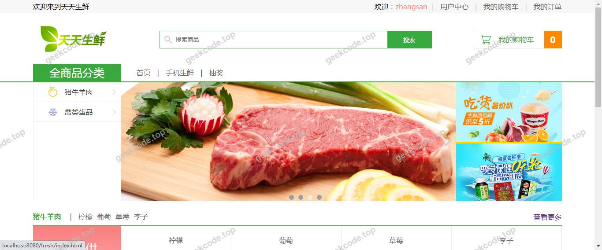
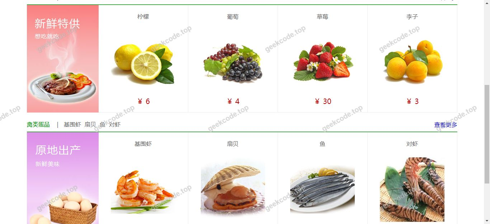
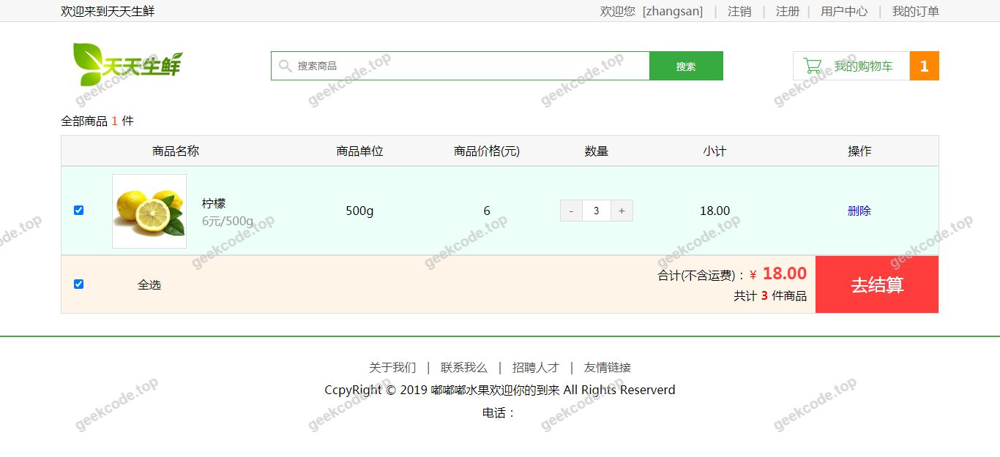
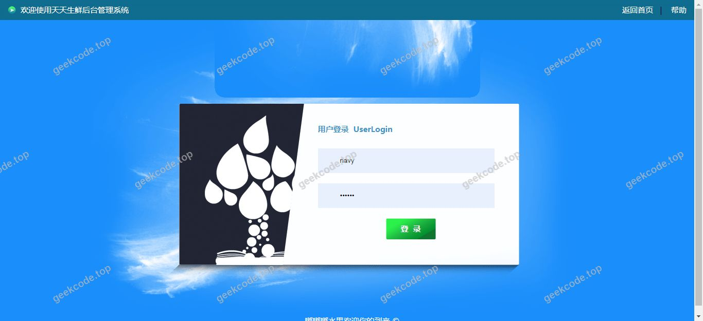
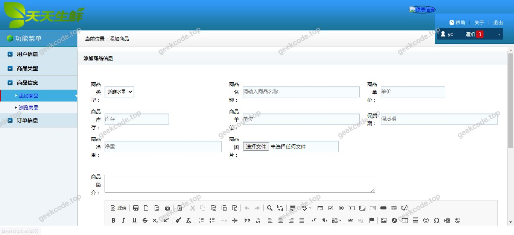
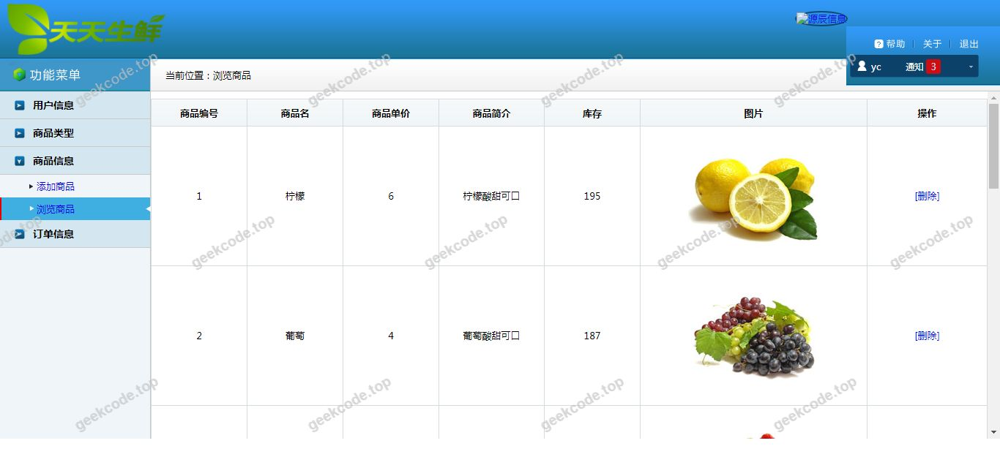

# java精品源码-在线水果商城系统

> 🎓 **计算机毕业设计 · java精品源码-在线水果商城系统**
>
> 本仓库只放**项目介绍 + 运行截图**（截图是站点带水印的原图，存在仓库 `images/` 里）。
>
> 👉 **完整可运行源码 / 数据库脚本 / 部署文档：[点我获取](https://geekcode.top/archives/java%E7%B2%BE%E5%93%81%E6%BA%90%E7%A0%81-%E5%9C%A8%E7%BA%BF%E6%B0%B4%E6%9E%9C%E5%95%86%E5%9F%8E%E7%B3%BB%E7%BB%9F?utm_source=github)**
>
> 💬 咨询微信：**ir9372**　|　🌐 更多项目：[极客代码 geekcode.top](https://geekcode.top/?utm_source=github)
>
> 📌 项目详情页：<https://geekcode.top/archives/java%E7%B2%BE%E5%93%81%E6%BA%90%E7%A0%81-%E5%9C%A8%E7%BA%BF%E6%B0%B4%E6%9E%9C%E5%95%86%E5%9F%8E%E7%B3%BB%E7%BB%9F?utm_source=github>

<table><td width="230" align="center"> <b>扫码加微信 ir9372</b></td><td valign="middle">📦 源码 = 项目介绍 + 全部运行截图 + 数据库 + 部署文档 👉 点上方任意截图，直接跳到 <b>极客代码 geekcode.top</b> 详情页</td></table>

---

<h1>java精品源码-在线水果商城系统</h1>
<h2>项目概述</h2>

本项目为“java精品源码-在线水果商城系统”，是一个基于 Java 技术栈构建的后端服务系统。该项目定位为纯 API 接口形式（pure-api），不包含独立的前台用户界面或后台管理界面，主要提供数据交互与业务逻辑处理能力。核心功能围绕在线水果商城的业务需求展开，通过 RESTful API 提供商品查询、订单处理及用户信息管理等基础服务能力。适用场景主要为需要集成水果销售业务逻辑的开发环境，或作为毕业设计中的后端支撑模块进行演示与分析。技术架构采用经典的 MVC 分层设计思想，依赖 Spring 框架体系实现控制层与业务层的解耦，结合 MyBatis 完成持久化操作，并利用 Redis 提升数据访问效率。

<h2>技术架构</h2>

本项目采用前后端分离架构中的后端服务模式，前端展示层缺失，专注于服务端逻辑实现。

<strong>1. 核心技术选型：</strong>

<ul>
<li><strong>Web 层框架</strong>：使用 <code>spring-webmvc</code> 处理 HTTP 请求映射与响应，配合 <code>javax.servlet-api</code> 和 <code>javax.servlet.jsp-api</code> 实现 Servlet 容器兼容。</li>
<li><strong>业务与数据层</strong>：采用 <code>spring-jdbc</code> 和 <code>mybatis-spring</code> 整合数据库操作，利用 <code>commons-dbcp</code> 连接池管理 MySQL 数据库连接，确保高并发下的资源复用。</li>
<li><strong>序列化与通信</strong>：引入 <code>jackson-databind</code> 负责 JSON 数据的序列化与反序列化，保证 API 接口的数据格式统一。</li>
<li><strong>缓存机制</strong>：集成 <code>Redis</code> 作为高性能键值对存储，用于缓存热点数据（如商品信息、用户会话等），降低数据库压力。</li>
<li><strong>切面编程</strong>：使用 <code>spring-aspects</code> 实现事务管理及日志记录等非功能性需求的模块化封装。</li>
</ul>

<strong>2. 数据库设计要点：</strong>
虽然未提供具体表结构，但基于水果商城业务及 MyBatis 特性，数据库设计应遵循第三范式，主要包含用户表、水果商品表、订单表及订单明细表。索引策略需针对高频查询字段（如商品分类ID、用户ID）进行优化，以配合 Redis 缓存形成多级存储架构。

<h2>功能模块</h2>

根据项目类型为 <code>pure-api</code> 且无前台/后台路由配置的信息，本项目的功能模块仅体现为后端 API 接口集合，具体如下：

<strong>1. 用户认证与管理模块</strong>

<ul>
<li>提供用户注册、登录验证的 API 接口。</li>
<li>支持用户基本信息（如收货地址、联系方式）的增删改查接口。</li>
</ul>

<strong>2. 商品信息管理模块</strong>

<ul>
<li>提供水果商品的列表查询接口，支持按类别、价格排序。</li>
<li>提供单个水果商品详情获取接口。</li>
<li>支持库存状态的实时查询接口。</li>
</ul>

<strong>3. 订单交易模块</strong>

<ul>
<li>提供创建订单的 API 接口，校验库存并生成订单记录。</li>
<li>提供订单状态更新接口（如支付成功、发货、完成）。</li>
<li>支持历史订单列表的分页查询接口。</li>
</ul>

<strong>4. 缓存服务模块</strong>

<ul>
<li>基于 Redis 的商品热点数据缓存读写接口。</li>
<li>用户 Session 或 Token 的存储与失效管理接口。</li>
</ul>

<em>注：由于项目明确标识为“是否有前台: 否”、“是否有后台: 否”，故不存在可视化的前端页面功能模块，所有功能均通过代码调用 API 实现。</em>

<h2>用户角色与权限</h2>

鉴于本项目为纯后端 API 系统且未提供具体的权限配置文件或角色定义代码，根据现有信息无法确定具体的角色划分。但在典型的水果商城后端设计中，通常隐含以下逻辑角色及其对应的 API 访问权限范围：

<strong>1. 普通消费者（Guest/User）</strong>

<ul>
<li><strong>可访问功能</strong>：浏览商品列表、查看商品详情、注册账号、登录、下单购买、查询个人订单。</li>
<li><strong>限制</strong>：无法访问管理员专用的数据修改接口，无法查看所有用户的订单数据。</li>
</ul>

<strong>2. 系统管理员（Admin）</strong>

<ul>
<li><strong>可访问功能</strong>：添加/编辑/删除水果商品信息、管理库存、查看所有订单记录、处理退款申请、管理用户账号状态。</li>
<li><strong>限制</strong>：此角色的存在依赖于后台管理界面的缺失，推测其权限通过特定的 API Key 或内部网络访问控制来实现，而非通过公开的前端菜单。</li>
</ul>

<em>说明：实际权限控制细节需依据源码中拦截器（Interceptor）或过滤器（Filter）的具体配置而定，当前上下文未提供详细的安全配置代码，故以上为基于业务逻辑的标准推断。</em>

<h2>项目特色与创新点</h2>

<strong>1. 轻量级 API 优先设计</strong>
项目摒弃了传统单体应用中臃肿的前端页面渲染逻辑，专注于提供高效、稳定的 RESTful API。这种设计使得后端服务可以灵活对接多种前端载体（如微信小程序、Android/iOS App、Vue/React 网页），符合现代微服务架构的发展趋势。

<strong>2. 多级数据一致性保障</strong>
通过引入 Redis 缓存层与 MySQL 持久层的双写机制，项目在解决高并发读取性能瓶颈的同时，保证了数据的最终一致性。特别是在水果这类时效性强的商品管理中，快速的数据响应能显著提升用户体验。

<strong>3. 模块化技术栈组合</strong>
采用 Spring WebMVC + MyBatis + DBCP 的经典组合，避开了过度复杂的 ORM 框架带来的学习曲线和维护成本，同时保留了足够的灵活性。Jackson 的使用确保了 JSON 数据交换的标准化，便于第三方系统集成。

<strong>4. 面向毕设的教学价值</strong>
作为“java精品源码”，该项目结构清晰，层次分明，非常适合计算机专业学生理解后端分层架构、数据库连接池原理以及缓存穿透/雪崩等常见问题的解决方案，具有较高的学习和参考价值。

<h2>部署环境</h2>

运行本项目所需的软件环境如下：

<strong>1. 开发环境与运行时</strong>

<ul>
<li><strong>JDK 版本</strong>：建议 JDK 1.8 或以上版本（Spring WebMVC 及 MyBatis 主流版本对 JDK 8+ 兼容性最佳）。</li>
<li><strong>构建工具</strong>：Maven 3.x 或 Gradle（用于依赖管理，尽管上下文中未显式提及 pom.xml，但 Java EE 项目通常依赖此类工具）。</li>
</ul>

<strong>2. 数据库与中间件</strong>

<ul>
<li><strong>MySQL</strong>：版本 5.7 或 8.0，需安装 <code>mysql-connector-java</code> 驱动。</li>
<li><strong>Redis</strong>：版本 5.0 或更高，用于缓存服务，需启动 Redis Server 并确保端口连通性。</li>
</ul>

<strong>3. 应用服务器</strong>

<ul>
<li><strong>Servlet 容器</strong>：Tomcat 8.5 或 9.0（因依赖 <code>javax.servlet-api</code>，需兼容 Servlet 3.1+ 规范）。</li>
<li><strong>注意</strong>：由于是 pure-api 项目，也可打包为 Jar 包内嵌 Tomcat/Jetty 直接运行，或使用外部容器部署 War 包。</li>
</ul>

<strong>4. 操作系统</strong>

<ul>
<li>Windows 10/11, Linux (CentOS/Ubuntu), macOS 均可。</li>
</ul>
<h2>五、技术特性</h2>
<ul>
<li>使用 Redis 缓存提升系统性能</li>
</ul>
<h2>六、功能模块截图</h2>
<h3>前台用户端</h3>
<h4>系统运行界面1</h4>

<h4>系统运行界面2</h4>

<h4>系统运行界面3</h4>

<h4>系统运行界面4</h4>

<h4>系统运行界面5</h4>

<h4>系统运行界面6</h4>

---

## 获取完整源码

| 项目 | 说明 |
| --- | --- |
| 项目名 | java精品源码-在线水果商城系统 |
| 运行截图 | 本文 6 张（站点带水印原图，仓库 `images/` 目录） |
| 完整源码 | [https://geekcode.top/archives/java%E7%B2%BE%E5%93%81%E6%BA%90%E7%A0%81-%E5%9C%A8%E7%BA%BF%E6%B0%B4%E6%9E%9C%E5%95%86%E5%9F%8E%E7%B3%BB%E7%BB%9F?utm_source=github](https://geekcode.top/archives/java%E7%B2%BE%E5%93%81%E6%BA%90%E7%A0%81-%E5%9C%A8%E7%BA%BF%E6%B0%B4%E6%9E%9C%E5%95%86%E5%9F%8E%E7%B3%BB%E7%BB%9F?utm_source=github) |
| 咨询微信 | **ir9372**（备注：jingpin-yuanma） |
| 更多项目 | [极客代码 geekcode.top](https://geekcode.top/?utm_source=github) |

> 需要源码、部署、改配置、跑不起来等问题，加微信 ir9372 沟通，说明项目名即可。
